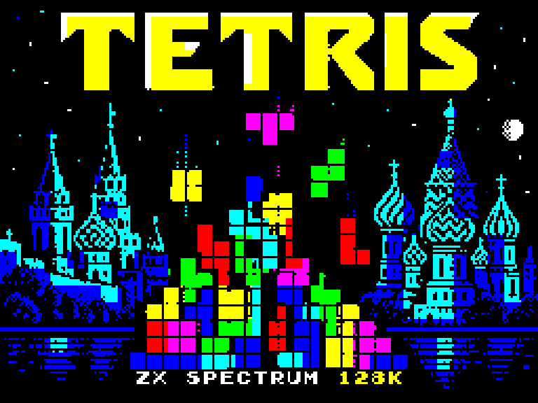

# Tetris GB

An unofficial native Z80 recreation of Game Boy Tetris for the **ZX Spectrum 128K**, featuring coloured pieces, AY music and sound effects, QAOP keyboard controls and Kempston joystick support.

**Developed with assistance from OpenAI's ChatGPT**, including code generation, graphics conversion, AY audio adaptation, debugging, testing and documentation. Project direction and feedback were provided by MmmPT.



## Game page

### [Play Tetris GB in your browser ↗](https://mmmpt.github.io/tetris-gb-zx-spectrum/)

Play online with keyboard or touch controls, watch the gameplay video, or download the game from the dedicated page.

## Download and play

- [Tetris_GB.tap](dist/Tetris_GB.tap): tape image with a dedicated loading screen.
- [Tetris_GB.z80](dist/Tetris_GB.z80): snapshot for immediate play.
- [Gameplay video with AY sound](media/Tetris_GB_gameplay.mp4).

Select a **Spectrum 128K** machine in your emulator. Select Kempston if using a joystick. On a 128K Spectrum, the tape can be loaded from 48 BASIC using `LOAD ""`; AY audio remains available. This game requires 128K hardware.

## Controls

| Key | Action |
| --- | --- |
| Q | Rotate |
| A | Soft drop |
| O / P | Move left / right |
| Enter | Start, pause/resume, confirm results |
| M | Toggle music; sound effects remain active |
| N | Show/hide the next piece |
| 1 | Return to the menu, retaining session records |

Release A between pieces to re-enable manual dropping for the next piece.

Kempston is enabled by default alongside the keyboard. Left/right move, down drops and fire rotates. Fire also starts from the menu and confirms results. During name entry, up/down select a letter and left/right move the cursor. Press K in the menu to toggle Kempston; J indicates that it is enabled.

## Menu and game modes

| Key | Setting |
| --- | --- |
| O / P | Starting level 0–9 |
| B | A-Type / B-Type |
| H | B-Type starting height 0–5 |
| T | Music A, B or C |
| L | Toggle heart difficulty |
| R | Show records for the selected difficulty |

**A-Type** is continuous play: score points and clear lines as the level increases.

**B-Type** is a single challenge to clear **25 lines**, at the selected starting speed and pile height. Completing it leads to the results screen; it does not automatically advance to another level.

**Heart difficulty** increases falling speed by ten levels, capped at level 20. The heart is a difficulty modifier, not an extra life. It is indicated by H next to the level in this adaptation.

After approximately 15 seconds in the menu, a built-in automatic demonstration starts. QAOP or Enter cancels it.

## Scores and endings

B-Type results show singles, doubles, triples, tetrises, soft-drop points, subtotals and the total. Enter advances through results, endings and records. For a new record, Q/A select letters, O/P move the cursor and Enter confirms.

There are three six-letter entries per difficulty group, with separate normal and heart tables: 140 groups across A-Type levels and B-Type level/height combinations. Records are held in RAM for the current session. Reloading the initial snapshot or restarting the machine clears them.

Adapted endings include A-Type rockets by score, B-Type dancers at level 9 and the Buran sequence at level 9/height 5.

## What this project is based on

The reference is [kaspermeerts/tetris](https://github.com/kaspermeerts/tetris), a disassembly of **Tetris (JUE) v1.1** for Game Boy. Reference ROM SHA-1: `74591cc9501af93873f9a5d3eb12da12c0723bbc`.

This project implements a native Spectrum engine informed by that disassembly and adapts original graphical and musical data to Spectrum hardware. The engine, rendering, input and AY playback are specific to the Spectrum. The reference source used by the asset tools is retained under `reference/tetris-master/`.

Original graphics, musical compositions and other third-party material remain attributable to their respective rights holders. This is an unofficial fan project, unaffiliated with the original developers, publishers or rights holders. No blanket licence for third-party assets is asserted by this repository.

## Adaptations and limitations

- Coloured 8×8 pieces and monochrome patterned scenery adapt the original four-shade graphics.
- Four Game Boy audio channels are adapted to the AY's three channels and noise generator. Timbres, envelopes, sweeps and mixing differ.
- Menus, random generation, name entry, result presentation, attract play and ending choreography are adaptations.
- The original top-row duplication bug during line compaction is not reproduced.
- Frame-by-frame equivalence with an executing Game Boy ROM has not been certified.
- One player only. Tested in emulation; physical Spectrum hardware has not yet been tested.

## Build

Python 3 is required. Install the dependencies in `requirements.txt`:

```sh
python -m pip install -r requirements.txt
python src/assets.py
python src/build.py
```

The project includes a two-pass assembler wrapper using SkoolKit. No separate Z80 assembler is needed. The build generates the `.bin`, `.tap` and `.z80` files in `dist/` and converts the loading illustration to a real 6912-byte Spectrum screen.

## Validation

```sh
python src/validate.py
python src/validate_v3.py
python src/validate_kempston.py
python src/validate_colours.py
python src/validate_preview.py
python src/validate_loading.py
python src/validate_clear_animation.py
```

Checks cover collision fixtures, one-to-four-line clears, scoring, compaction, levels, controls, AY playback, records, endings and a complete B-Type game. Dedicated rendering checks cover all 28 piece orientations, all seven next-piece previews in A/B modes, colour restoration, shadow-screen compaction and tape loading. Included JSON files retain results from the validated development build.

To record 40 seconds of emulator gameplay with audio derived from actual AY register writes, install FFmpeg and run:

```sh
python src/record_demo.py
```

The included 43-second video presents the loading image for three seconds, then shows the menu and 40 seconds of actual emulation. Between gameplay seconds 24 and 30, music is muted to make sound effects easier to hear. The opening is a still presentation of the loading screen, not a recording of the complete tape-loading process.

## Development notes

The published download filenames are `Tetris_GB.*`. Development included corrections to line clearing, next-piece positioning, coloured piece attributes and loading-screen lettering.
